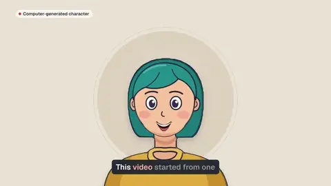

# avatar-studio

[](https://github.com/VinVirtual/avatar-studio/actions/workflows/test.yml) [](LICENSE)



One illustrated portrait and a script in; a video of that character speaking the script out. Everything runs on your own machine: no paid video or voice service, and nothing is uploaded unless you choose `avatar head --source space --yes`, which **uploads the portrait to a third party** (the public Hunyuan3D-2 demo on Hugging Face, run by Tencent) to get a better head shape.

It is a [Claude Code](https://claude.com/claude-code) skill (the assistant reads `SKILL.md`) and a plain command line (`avatar`) you can run yourself. **Tested on Linux only.**

Example: [`examples/juno/juno.mp4`](examples/juno/juno.mp4) (27 s, 720p, 1.1 MB, poster [`poster.jpg`](examples/juno/poster.jpg)), made from [`examples/juno/script.json`](examples/juno/script.json).

## What it does

1. **Head.** Builds a small 3D head from the portrait with the [talking-head](#requirements) skill (or reuses a `head.glb` + `head.json` you already have).
2. **Voice.** Speaks the script with the [Kokoro](https://huggingface.co/hexgrad/Kokoro-82M) text-to-speech model on your machine, measures when every word starts from the model's own phoneme durations, and records how loud the voice is at every video frame.
3. **Performance.** Turns that into motion: the mouth opens with the loudness, the eyes blink on a seeded schedule, the head sways a little, nods on stressed words (`*like this*`), and glances towards the side panel when a point appears. Every frame is a pure function of its time, so frames render in parallel and the same script gives the same video, bit for bit.
4. **Video.** Draws every frame in headless Chrome (the head through talking-head's three.js viewer, the rest on a 2D canvas) and pipes them to ffmpeg: an MP4 with burned-in captions, `.vtt` and `.srt` files, a small 720p web copy with a poster, and a looping WebP/GIF preview.

Around the character there is, when the script asks for it: a title card, a name strap (lower third), a side panel of points that appear on the word that names them, and an end card. A **"Computer-generated character"** label is on every frame and cannot be switched off. Landscape (1920x1080), vertical (1080x1920) and square (1080x1080).

After rendering, `avatar video` decodes the sound back out of the finished MP4 and checks it against the mouth it drew. For the example: mouth vs sound energy correlation r = 0.86, best alignment with the mouth one frame ahead of the sound (as designed), mouth shut while the voice is loud in 0% of frames.

## Use it responsibly

- **Faces.** Use an invented character, or a picture of someone who has agreed to this use. Do not make videos of public figures or of people who have not consented. avatar-studio cannot tell who a picture shows: the script must *declare* it in `character.likeness` (`original`, `licensed` or `real-person-with-consent`). Lint runs before every render (`sheet`, `stills`, `video`, `build`) and refuses a script with no declaration, and refuses `real-person-with-consent` unless `"consent": true` is set too. Both are your own statements; the tool cannot verify them.
- **Words.** Never make a character impersonate a real person or present lines as a real person's words, quotes or endorsements.
- **Labelling.** Keep the on-screen label, and say the video is computer-generated wherever you post it (caption, description, page text). Follow each platform's rules for synthetic media.
- **Claims.** The character says everything confidently. Check every factual claim in the script before you publish. The skill tells the assistant to list them for you to confirm.

## Honest limits

- **Cartoon heads only.** It works with illustrated, front-facing, head-and-shoulders portraits. It is not for photographs and does not capture a likeness.
- **The mouth follows loudness, not speech sounds.** It opens on loud sounds and closes in pauses. There are no phoneme mouth shapes, so it is not lip-sync and cannot be lip-read.
- **Small head turns.** talking-head's heads look right from the front; past about 35 degrees the sides are plain colour and stretched lines. avatar-studio keeps turns small (glances reach about 40% of the head's own turn limit).
- **Quality comes from talking-head.** With its offline shape (`--source inflate`) the head is a puffy balloon with a nose bump in profile; eyelids and the open mouth are simple drawn overlays that suit flat cartoon styles.
- **One character, one voice.** No two-person scenes. English voices are the best tested.
- **Speed.** WebGL runs in software in headless Chrome: about 4 to 5 frames a second with two pages, so 30 seconds of landscape video takes about 3 minutes.
- **Tested on Linux only** (Ubuntu, Node 24, Chrome, Python 3.10). macOS may work; Windows is untested.

## Requirements

| Needed | Why | Licence |
|---|---|---|
| [talking-head](#install) skill | builds the head; its `viewer/viewer.js` draws it | MIT |
| Blender 4.2 or newer | only to build a new head (talking-head runs it) | GPL-2.0-or-later |
| Node.js 18 or newer | runs the command line and the renderer | MIT |
| [three.js](https://www.npmjs.com/package/three) 0.170 | talking-head's viewer is built on it | MIT |
| [playwright-core](https://www.npmjs.com/package/playwright-core) | drives the browser | Apache-2.0 |
| Google Chrome or Chromium | draws the frames (WebGL) | Chrome: Google's terms; Chromium: BSD-3-Clause and others |
| Python 3.10 to 3.13 with [kokoro-onnx](https://github.com/thewh1teagle/kokoro-onnx) 0.6 or newer, soundfile, numpy | speaks the script | MIT, BSD-3-Clause, BSD-3-Clause |
| Kokoro model files `kokoro-v1.0.onnx`, `voices-v1.0.bin` (about 340 MB) | the voice model | Apache-2.0 (model card) |
| ffmpeg (or the `imageio-ffmpeg` Python package, which ships one) | encodes the video | LGPL/GPL, depending on the build |

None of these is included in this repository. You install them yourself, and their licences apply to your use of them. About 2 GB of free memory is enough; no GPU is needed.

### Licence notes

Checked on 21 November 2026 against each package's own metadata or project page. Check again before you rely on them. This is not legal advice.

- **avatar-studio's own code** is under the **MIT License** (`LICENSE`). Parts are adapted from reel-studio by the same author (MIT): `engine/word_timing.py` is a copy, and `engine/gen_audio.py`, `engine/lib/env.mjs`, the frame-to-ffmpeg loop in `engine/lib/render.mjs` and the caption grouping in `engine/lib/plan.mjs` are adapted from it.
- **Bundled fonts** (`assets/fonts/`): Instrument Serif (Copyright 2022 The Instrument Serif Project Authors) and Geist (Copyright 2024 The Geist Project Authors) are under the **SIL Open Font License 1.1**, as the licence field inside each font file says. `assets/fonts/OFL.txt` carries the notices and the licence.
- **The example character, Juno** (`examples/juno/head/`), is an original, fictional drawing from talking-head (MIT, same author): `portrait.png`, `head.glb` and `head.json` are copied unchanged from talking-head's `examples/juno`. She is not a real person. The example video's voice was made with Kokoro (`af_heart`) and is not a recording of anyone.
- **kokoro-onnx** is MIT (its `LICENSE` file, 0.6.1). **onnxruntime** is MIT, **soundfile** BSD-3-Clause, **numpy** BSD-3-Clause, **imageio-ffmpeg** BSD-2-Clause (package metadata).
- **Kokoro-82M**: the model card says `License: apache-2.0` and that it was trained on permissive or non-copyrighted audio. It gives no separate licence for the voice files.
- **phonemizer** (GPL-3.0-or-later, package metadata) and **eSpeak NG** ("released under the GPL version 3 or later", its README; kokoro-onnx loads it through the `espeakng-loader` package, whose metadata states no licence) run inside the Python process that speaks the script. avatar-studio only starts that process and does not include or link them. If you redistribute a bundle that includes them, read the GPL.
- **ffmpeg** runs as a separate program. The copy that `imageio-ffmpeg` ships on Linux is built with `--enable-gpl --enable-version3`, so that binary is GPL-3.0.
- **Blender** (GPL) runs as a separate program, only through talking-head. See talking-head's README for the licence of its optional public generator (`--source space`), which uploads the picture and does not cover the EU, UK or South Korea.
- **Videos you make** are yours, subject to the rules above. Check the licence of any portrait you use.

## Install

```bash
# 1. the two skills
git clone https://github.com/VinVirtual/avatar-studio ~/.claude/skills/avatar-studio
git clone https://github.com/VinVirtual/talking-head ~/.claude/skills/talking-head     # or set TALKING_HEAD_DIR=/path/to/talking-head
cd ~/.claude/skills/avatar-studio && npm install                          # three.js for the render page

# 2. the voice
python3 -m venv ~/kokoro/.venv
~/kokoro/.venv/bin/pip install "kokoro-onnx>=0.6" soundfile numpy imageio-ffmpeg   # 0.6+ gives measured word times
curl -L -o ~/kokoro/kokoro-v1.0.onnx https://github.com/thewh1teagle/kokoro-onnx/releases/download/model-files-v1.1/kokoro-v1.0.onnx
curl -L -o ~/kokoro/voices-v1.0.bin  https://github.com/thewh1teagle/kokoro-onnx/releases/download/model-files-v1.1/voices-v1.0.bin

# 3. the browser driver (and Chrome or Chromium, if you have neither)
npm i -g playwright-core

~/.claude/skills/avatar-studio/avatar check
```

Every location can be changed with an environment variable: `TALKING_HEAD_DIR`, `AVATAR_THREE` (a three.js folder), `KOKORO_HOME`, `KOKORO_MODEL`, `KOKORO_VOICES`, `AVATAR_PYTHON`, `FF` (ffmpeg), `PLAYWRIGHT_CORE`, `AVATAR_CHROME`.

## Quick start

```bash
A=~/.claude/skills/avatar-studio
$A/avatar new my-video --head $A/examples/juno/head   # reuse Juno's head (or --portrait drawing.png, then: avatar head my-video)
# edit my-video/script.json  (fields: references/script.md)
$A/avatar lint my-video
$A/avatar audio my-video
$A/avatar sheet my-video          # look at my-video/stills/my-video-sheet.png
$A/avatar video my-video --web    # my-video/out/my-video.mp4, .vtt, .srt and out/web/
```

`avatar build my-video` does lint, audio (when the lines changed), sheet, video, web copy and the looping preview in one go. Add `--format vertical` or `--format square` for the other shapes.

## Commands

| Command | Does |
|---|---|
| `avatar check` | checks talking-head, three.js, Kokoro, ffmpeg, Playwright and that the browser has WebGL |
| `avatar new <dir> [--portrait FILE \| --head DIR]` | starts a project: `script.json`, and the portrait or a copy of an existing head |
| `avatar lint <dir> [--format f] [--json]` | checks the script: likeness declared, consent for a real person, the label present and short enough, points on real words, panel capacity, colours and contrast, voice settings, the head folder inside the project. `sheet`, `stills`, `video` and `build` run it first and stop on errors |
| `avatar head <dir> [--mesh FILE] [--marks FILE] [--force]` | builds `head/head.glb` and `head/head.json` from the portrait with talking-head, offline. If the portrait changed since its marks were made it stops; `--force` estimates new marks |
| `avatar head <dir> --source space --yes` | the same, but **uploads the portrait to a third party** (the public Hunyuan3D-2 demo on Hugging Face, run by Tencent) for a better shape. Only with the agreement of whoever owns the picture; see talking-head's README for that model's licence limits |
| `avatar audio <dir>` | voice (`build/voice.wav`), word times and per-frame loudness (`build/timeline.json`) |
| `avatar sheet <dir> [--format f]` | `stills/<name>-sheet.png`: one frame per beat (title, each line at its widest mouth, each point, a blink, the end card) |
| `avatar stills <dir> 1.5 4 9 [--format f]` | single frames at those seconds |
| `avatar video <dir> [--web] [--format f] [--no-captions] [--workers 1\|2]` | `out/<name>.mp4`, `.vtt`, `.srt`, a sync report (`build/<name>.sync.json`); `--web` adds `out/web/` (720p MP4, poster JPEG, captions) |
| `avatar build <dir> [--format f] [--force]` | all of the above, plus `out/web/<name>-preview.webp` and `.gif` |
| `avatar test` | the unit tests (`node --test`) |

## How it works

| Stage | What happens | Sample from the example |
|---|---|---|
| Voice | Kokoro speaks each line; word starts come from the model's phoneme durations | `{ "w": "portrait", "t": 10.185 }` |
| Loudness | RMS of the voice over 1.5 frames, for every frame | frames 304 to 309: `0.120 0.067 0.013 0.007 0.056 0.084` |
| Mouth | dB below a 90th-percentile reference, mapped to 0 to 0.92, faster to open than to close, one frame early | the same frames: `0.83 0.56 0.36 0.58 0.73 0.71` |
| Frame | `poseAt(t)` = sway + blinks + nods + glances, drawn with `renderPose`, composited, piped to ffmpeg | at 10.285 s, glancing at the new point: `{ yaw: 0.23, pitch: -0.003, eyes: 0, mouth: 0.72 }` |

The 70 unit tests in `tests/` (`avatar test`) cover the loudness-to-mouth mapping, blink determinism, layout maths, lint rules, the timeline-to-plan mapping, the render server's path checks, and that Python probes and Playwright never load code from the current folder.
